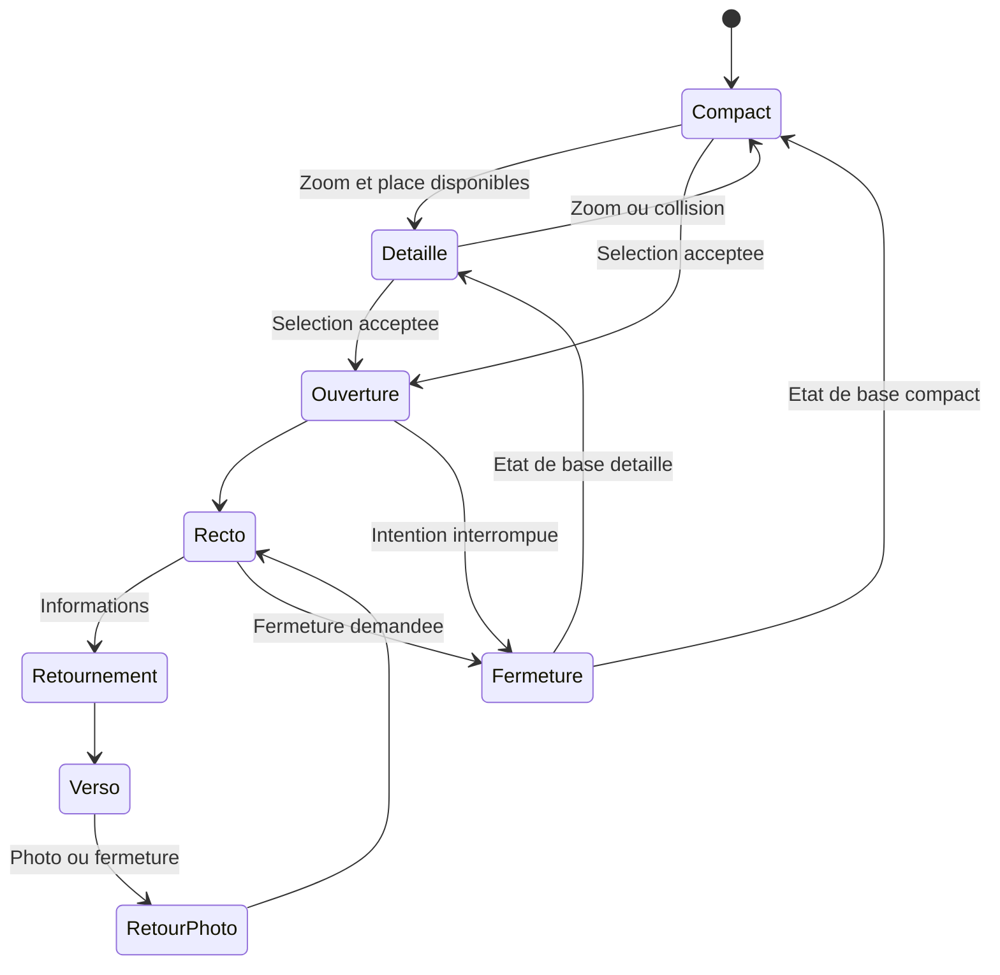
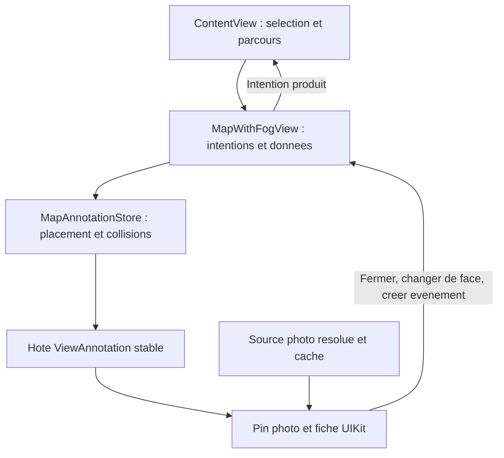

# Pins photo et fiche animee fideles a la video - Plan

La rédaction de cette spec corrective et l'exception de design limitée aux pins des adresses enregistrées et à leur fiche ont été approuvées par Samuel le 24 octobre 2026 : "oui j'approuve, y compris l'exception au design iOS natif."

Après livraison de cette spec, Samuel a demandé "implemente" le 24 octobre 2026. Cette instruction approuve l'exécution du sprint présenté, en plus de la rédaction et de l'exception visuelle déjà approuvées. L'ancien plan est conservé comme historique.

## Goal Capsule

Samuel doit retrouver dans Wander les petits pins photo, leur forme agrandie avec catégorie au-dessus, puis la transformation du pin touché en fiche photo retournable sur la carte. La ressemblance doit être visible dans un enregistrement du simulateur.

Le sprint utilise la carte Mapbox et les vues UIKit existantes. Il concerne uniquement les adresses enregistrées. La carte pastel, les pins sociaux, le brouillard et les contrôles environnants gardent leur comportement actuel.

L'exception au design iOS natif autorise la silhouette photo avec bord blanc, pointe, lettrage de catégorie façon autocollant et fiche ancrée animée. Elle ne constitue pas une refonte générale de l'application. Cette décision a été approuvée explicitement après présentation de l'écart avec la vidéo.

Ce document remplace la cible visuelle du [plan précédent](/Users/samuelbarraud/Documents/code/wander/docs/plans/2026-10-24-pins-adresses-etats-animations.md), conservé comme historique de l'implémentation. Ses exclusions concernant les photos, le lettrage et le retournement ne s'appliquent plus à ce sprint.

Avant de coder, obtenir l'approbation explicite de ce sprint, puis passer `status` à `approved`, puis `in_progress`. Ne pas redemander l'exception visuelle déjà accordée. Un seul sprint est décrit ici ; les unités ci-dessous sont ses étapes, pas des sprints approuvés séparément. Les règles de [AGENTS.md](/Users/samuelbarraud/Documents/code/wander/AGENTS.md) s'appliquent, notamment la préservation du travail existant et l'interdiction des commandes Git mutatrices.

Décision Q1 du 24 octobre 2026 pendant l’implémentation : à la demande de lien Naver, Samuel répond « j ái pas, met des pins au hasard ». Les pins utilisent donc des visuels illustratifs locaux variés, associés de façon stable à chaque adresse. Leur verso précise « Illustration ». Cette décision remplace l’exigence initiale de photos réelles vérifiées ; la géométrie et les animations restent inchangées.

---

## Product Contract

### Summary

Les trois états produit sont compact, détaillé et sélectionné. Le sélectionné contient une fiche avec un recto photo et un verso d'informations. Ouverture, retournement et fermeture sont des phases d'animation de cet état, pas de nouvelles sélections.

### Problem Frame

La première spec conservait le symbole iOS, le cercle Liquid Glass et la fiche native en bas de l'écran. Le code les a agrandis et animés, mais cette cible omettait les caractéristiques reconnaissables de la vidéo. Les tests de cette version ne constituent donc pas une validation de fidélité à la référence.

### Reference visuelle obligatoire

Source fournie par Samuel : [vidéo originale](/Users/samuelbarraud/Downloads/8WlF_NQxpVslwGdX.mp4), durée 24,37 s, 1080 × 1080, 60 images/s. Visionner la vidéo avant l'implémentation et lors de la recette. Les captures ci-dessous proviennent de ses images aux temps indiqués. Elles ne sont ni des maquettes générées ni des photos à réutiliser dans le produit.

Si la vidéo manque dans le nouveau contexte, les images permettent de préparer le rendu statique, mais retrouver la vidéo avant de conclure sur les animations. Le mécanisme interne de l'application filmée, sa police exacte, ses seuils de zoom et ses courbes d'animation ne sont pas connus.

| Repère | Ce qui est observable | Conséquence pour Wander |
|---|---|---|
| [0,00 s](/Users/samuelbarraud/Documents/code/wander/docs/plans/assets/2026-10-24-pins-adresses-fidelite-video/reference-00.00.jpg) | Petites photos circulaires bordées de blanc. | Le compact conserve une image, même sans texte. |
| [3,00 s](/Users/samuelbarraud/Documents/code/wander/docs/plans/assets/2026-10-24-pins-adresses-fidelite-video/reference-03.00.jpg) | Coexistence de petits cercles et de grands pins photo à pointe, catégorie noire bordée de blanc au-dessus. | Deux silhouettes distinctes ; la catégorie ne devient pas un label latéral. |
| [7,90 s](/Users/samuelbarraud/Documents/code/wander/docs/plans/assets/2026-10-24-pins-adresses-fidelite-video/reference-07.90.jpg) | Le pin s'étire vers une fiche tout en conservant la photo et la pointe. | Une transformation continue relie les deux formes. |
| [8,50 s](/Users/samuelbarraud/Documents/code/wander/docs/plans/assets/2026-10-24-pins-adresses-fidelite-video/reference-08.50.jpg) | Fiche photo arrondie avec catégorie au-dessus, nom et pointe en bas ; carte visible autour. | La sélection ouvre une fiche sur la carte. |
| [9,00 s](/Users/samuelbarraud/Documents/code/wander/docs/plans/assets/2026-10-24-pins-adresses-fidelite-video/reference-09.00.jpg), [9,50 s](/Users/samuelbarraud/Documents/code/wander/docs/plans/assets/2026-10-24-pins-adresses-fidelite-video/reference-09.50.jpg) | Fiche vue de profil durant la rotation, puis face d'informations. | Prévoir un vrai retournement autour de l'axe vertical. |
| [12,65 s](/Users/samuelbarraud/Documents/code/wander/docs/plans/assets/2026-10-24-pins-adresses-fidelite-video/reference-12.65.jpg), [12,80 s](/Users/samuelbarraud/Documents/code/wander/docs/plans/assets/2026-10-24-pins-adresses-fidelite-video/reference-12.80.jpg) | La fiche revient vers le cercle photo et le pin retrouve sa place. | La fermeture termine sur le pin, avec continuité de l'image et de l'ancre. |

Les plages à comparer en mouvement sont environ 0 à 7 s pour le zoom, 7,7 à 8,5 s pour l'ouverture, 8,8 à 9,3 s pour le retournement et 12,2 à 12,9 s pour le retour. Ces repères situent les séquences ; ce ne sont pas des durées d'animation mesurées.


Pour identifier les écarts à corriger, les captures [avant, détaillé](/Users/samuelbarraud/Documents/code/wander/docs/plans/assets/2026-10-24-pins-adresses-fidelite-video/avant-detaille.jpg) et [avant, sélectionné](/Users/samuelbarraud/Documents/code/wander/docs/plans/assets/2026-10-24-pins-adresses-fidelite-video/avant-selectionne.jpg) proviennent de la validation du premier plan. Elles documentent l'ancien rendu, pas la cible.

### Requirements

#### R1. Silhouette et contenu des trois etats

Les dimensions ci-dessous sont des valeurs initiales proposées pour Wander, en points iOS. Les ajuster après comparaison sur simulateur et consigner les valeurs finales. Elles ne sont pas des mesures tirées de la vidéo filmée en perspective.

| État | Forme et contenu | Valeurs initiales |
|---|---|---|
| Compact | Photo circulaire recadrée, bord blanc fin, pas de texte ; le bas du cercle représente le point géographique. | Diamètre extérieur 24 pt, bord 2 pt. |
| Détaillé | Même photo agrandie, bord blanc plus épais et petite pointe inférieure. Catégorie au-dessus, lettres noires épaisses avec contour blanc suivant les glyphes. | Diamètre extérieur 50 pt, bord 3 pt, pointe 6 pt, catégorie 13 à 15 pt. |
| Sélectionné | Le pin devient une fiche photo arrondie à bord blanc, avec une pointe inférieure. La catégorie reste au-dessus. Le nom apparaît sur le recto ; le verso contient les informations et actions de Wander. | Largeur maximale 300 pt, au plus largeur utile moins 32 pt ; photo principale proche du carré, rayon initial 20 pt. Hauteur bornée par le viewport utile. |

Le lettrage détaillé suit un arc léger au-dessus de la photo. Utiliser d'abord une police système arrondie et grasse avec dessin du contour ; la police exacte de la référence n'est pas identifiée. La catégorie complète reste intelligible, avec abréviation explicite pour les textes longs. En collision, revenir au compact plutôt qu'écraser le texte. Le nom du lieu n'apparaît pas à droite du pin détaillé. Le recto et le verso gardent toujours le nom complet accessible dans leur contenu.

Le cadre photo est opaque et blanc. Le rond Liquid Glass et le passage au bleu ne définissent plus le rendu principal. Une ombre légère n'est admise que si elle aide à distinguer le bord blanc sur la carte pastel, sans remplacer ce bord.

#### R2. Provenance et absence de photo

Les trois visuels locaux (café, jardin, repas) sont générés pour Wander et ne représentent pas les lieux importés. Un hash stable du `sourceID` choisit l’image ; compact, détaillé et recto partagent la même image et le même recadrage. Le verso indique « Illustration ». Aucun appel réseau, secret API, cache disque ni migration SwiftData n’est nécessaire.

Si un asset est absent, conserver la nouvelle silhouette et les transitions avec un symbole de catégorie sur fond neutre. Le verso indique « Photo indisponible ». Le scénario couvre aussi ce repli.

#### R3. Choix entre compact et detaille

Conserver comme point de départ les seuils existants de détail à zoom 14 et de retour sous 13,7, avec hystérésis. Ce sont des règles Wander, pas des seuils déduits de la vidéo. Admettre le détaillé seulement si photo, pointe et catégorie trouvent leur place.

Pendant un geste, conserver les présentations déjà admises tant que les collisions le permettent. Les réductions restent possibles ; les nouvelles promotions attendent l'arrêt de la caméra. Garder l'ordre stable existant et la mémorisation des masquages pendant le dézoom. Ne pas réintroduire de quota arbitraire ni de sélection par distance au centre.

#### R4. Ouverture et faces de la fiche

Toucher un compact ou un détaillé ouvre son recto au même endroit. Une seule adresse est sélectionnée. La fiche reste dans la carte et garde sa pointe reliée à la coordonnée ; la sélection ne présente plus automatiquement la sheet actuelle.

Sur le recto, le lettrage de catégorie chevauche le bord supérieur de la fiche. Le nom blanc se place dans le bas de la photo, avec un fond local sombre si le contraste l'exige. Un pied blanc distinct sous la photo termine le corps de la fiche et se prolonge par la pointe. Il accueille la commande identifiable "Informations", qui retourne la fiche. Cette composition reprend le repère 8,50 s ; un titre sous l'image ou une catégorie éloignée au-dessus ne donne pas le même résultat.

Le verso présente le nom, l'adresse, la liste importée, les avertissements de disponibilité ou de position et les actions existantes "Créer un événement" et ouverture Naver si disponible. Une commande "Photo" revient au recto. Les deux faces ont un bouton de fermeture. Le verso peut défiler si nécessaire.

Les notes, descriptions commerciales, galeries et compteurs visibles dans la vidéo ne sont pas des données disponibles dans Wander. Ne pas inventer ces contenus. Les boutons d'action internes gardent les composants et conventions iOS usuels.

#### R5. Transitions visibles et interrompables

| Transition | Mouvement attendu | Valeur initiale proposée |
|---|---|---|
| Compact vers détaillé | Agrandissement de la photo, apparition de la pointe et du lettrage ; petit amortissement à l'arrivée. | 240 ms, ressort léger. |
| Détaillé vers compact | Retrait du lettrage, réduction de la photo et absorption de la pointe, sans déplacer le point géographique. | 200 ms. |
| Pin vers recto | La photo grossit et son masque circulaire devient un rectangle arrondi ; le cadre blanc se déploie, le contenu secondaire apparaît à la fin. | 380 ms, léger dépassement de taille, sans saut initial. |
| Recto vers verso, ou inverse | Rotation autour de l'axe vertical avec perspective ; échange de face à mi-course et texte jamais rendu à l'envers. | 360 ms. |
| Recto vers pin | Transformation inverse jusqu'au compact ou détaillé permis par la carte à cet instant. | 300 ms. |
| Fermeture depuis le verso | Retour au recto puis réduction au pin ; ne pas faire rétrécir le bloc de texte à la place de la photo. | Retournement 240 ms puis réduction 300 ms. |

Ces réglages devront être confrontés à la vidéo, pas seulement déclarés dans le code. Animer une sous-vue ou un masque en conservant une silhouette continue. Un fondu entre deux composants sans transformation visible ne satisfait pas l'ouverture ou la fermeture attendue.

Une nouvelle intention remplace l'animation courante à partir de l'apparence réellement affichée. Les callbacks obsolètes ne réouvrent pas une adresse précédente. À caméra fixe, la pointe, ou le bas du cercle compact, conserve la même projection avec une dérive maximale proposée de 1 pt dans les mesures intermédiaires.

Respecter la préférence système de réduction des animations via une transition simple, en conservant les mêmes états et actions. Maintenir les informations d'accessibilité natives ; aucun test dédié d'accessibilité n'est ajouté à ce sprint sans demande de Samuel.

#### R6. Interaction et cycle de selection

| Action ou événement | Résultat attendu |
|---|---|
| Tap sur le fond de carte ou bouton fermer | Fermeture selon R5, puis sélection vide. Le tap qui ouvre le pin ne déclenche pas cette fermeture. |
| Tap sur un autre pin B pendant que A est ouvert | A se ferme et B s'ouvre ; B devient l'unique sélection logique. Une dernière intention C reçue entre-temps remplace B. |
| Pan ou zoom avec une fiche ouverte | La fiche suit sa coordonnée, sans recentrage répété. Si le geste la pousse hors de la zone utilisable, fermer la fiche et libérer la sélection. |
| Tap sur "Créer un événement" | Fermer la fiche, puis ouvrir une seule fois le formulaire existant avec la bonne adresse et ses coordonnées. |
| Autre présentation modale prioritaire | Conserver les exclusions existantes ; ne pas laisser une sélection visuelle sans fiche. |
| Suppression du lieu, changement de compte, démontage de la carte | Annuler les animations et chargements concernés, supprimer la fiche et effacer la sélection. |
| Réimport du même lieu | Conserver l'identité, actualiser ses données ; ne pas rejouer l'ouverture. Fermer proprement si le lieu n'est plus affichable. |

Le défilement du verso ne déplace pas la carte. Les boutons de la fiche déclenchent leur action sans être interprétés comme un tap sur le pin. Les zones transparentes de son hôte laissent passer les gestes de carte.

#### R7. Ancrage, bords et collisions

Définir l'ancre une fois pour les trois états : bas du cercle en compact, extrémité de la pointe en détaillé et sélectionné. La photo se développe au-dessus de cette ancre. La transition ne doit pas recentrer l'ancre sur le centre du rectangle.

Pour une ouverture près d'un bord, utiliser le rectangle de carte réellement visible et ses marges de sécurité. Si la fiche ne tient pas, ajuster une seule fois la caméra par le déplacement minimal nécessaire, sans changer zoom ni inclinaison, puis déployer la fiche. Réduire sa hauteur et rendre son contenu défilable quand l'espace vertical est limité. La pointe reste attachée au lieu ; une fiche plaquée arbitrairement au bord de l'écran ne convient pas.

Le repositionnement initial ne s'applique qu'à l'ouverture. Les gestes ultérieurs appartiennent à l'utilisateur selon R6. Si aucune fiche utilisable ne tient, fermer ou refuser proprement l'ouverture et garder une carte interactive ; ne pas introduire silencieusement une autre présentation.

Pour les pins au repos, conserver la priorité actuelle des marqueurs sociaux. La fiche sélectionnée passe temporairement devant les annotations secondaires ; les parties recouvertes ne reçoivent aucun tap. Les contrôles fixes de l'application, le logo et l'attribution Mapbox restent visibles et utilisables. Les autres pins ne sont pas atténués globalement.

Réserver une enveloppe conservatrice couvrant le contenu pendant toute la transition, y compris le dépassement du ressort, la pointe, le lettrage et la projection durant le retournement. L'union des formes de départ et d'arrivée n'est qu'un minimum. Vérifier cette enveloppe sur les images intermédiaires et dans les tests de géométrie. Distinguer le contour visible, la réservation de collision et la cible tactile minimale de 44 pt. Une zone tactile ne justifie pas à elle seule le masquage des photos voisines.

### Perimetre et decision encore ouverte

Inclus : R1 à R7, visuels illustratifs locaux selon la décision Q1, continuité des actions existantes, tests ciblés, comparaison vidéo et documentation affectée.

Hors périmètre : changement du moteur ou du style de carte, refonte des marqueurs sociaux, nouveau clustering, galerie ou notation de lieux, changement de l'authentification, synchronisation Firebase des favoris, nouvelle bibliothèque UI. Un fournisseur payant, du scraping ou un backend d'images constituent des choix à présenter avant de les intégrer.

Q1 résolue — Samuel a explicitement choisi des pins illustratifs en réponse à la demande de liste Naver partagée. Les modèles et le flux actuels n’exposent pas d’image, et aucune réponse réelle permettant d’en établir une source n’a été disponible. La recherche de photos Naver réelles est hors de cette livraison. Source retenue : trois images créées avec l’outil intégré `image_gen`, stockées dans les assets de l’app, attribution stable par identifiant Naver. Aucun coût d’API à l’usage, aucune modification de modèle ou de parseur.

## Planning Contract

### Base technique observee

Le dépôt utilise Mapbox Maps iOS 11.32.0, SwiftUI pour les parcours, UIKit pour les annotations et SwiftData pour les adresses locales. Les cibles `wanderTests` et `wanderUITests` existent. Les indications historiques contraires dans certaines consignes ne décrivent plus le code inspecté.

| Point d'intégration | Observation et implication |
|---|---|
| [SavedPlaceAnnotation.swift](/Users/samuelbarraud/Documents/code/wander/wander/SavedPlaceAnnotation.swift) | Diamètres 28/40/48, matériau Liquid Glass, symbole et labels à droite. Remplacer ce rendu tout en conservant l'identité de l'annotation. |
| [MapAnnotations.swift](/Users/samuelbarraud/Documents/code/wander/wander/MapAnnotations.swift) | `MapAnnotationStore` héberge les vues dans `ViewAnnotation`, compense leur ancre et gère les collisions. La réservation actuelle du sélectionné n'est qu'un cercle. |
| [MapWithFogView.swift](/Users/samuelbarraud/Documents/code/wander/wander/MapWithFogView.swift) | Réconciliation par `place.id` et synchronisation de la sélection depuis le parent. `configure(with:)` est conditionnel ; un reset d'animation à chaque refresh n'est pas une cause établie. |
| [ContentView.swift](/Users/samuelbarraud/Documents/code/wander/wander/ContentView.swift) | `selectedSavedPlace` est lié à une sheet. Le callback refuse actuellement un autre lieu tant qu'il n'est pas nil. Le formulaire événement dépend du `onDismiss` de cette sheet. |
| `SavedPlaceDetailView.swift` (supprimé pendant ce sprint) | Source des informations, avertissements et actions à préserver sur le verso. |
| [MapViewportView.swift](/Users/samuelbarraud/Documents/code/wander/wander/MapViewportView.swift) | Fournit `visibleMapRect` et `visibleSafeMapRect`, à réutiliser pour les bords plutôt que `mapView.bounds` seul. |
| [SavedPlace.swift](/Users/samuelbarraud/Documents/code/wander/wander/SavedPlace.swift), [NaverListImport.swift](/Users/samuelbarraud/Documents/code/wander/wander/NaverListImport.swift) | Aucun champ photo ; absence de pipeline existant de téléchargement et cache photo. Les avatars locaux ne constituent pas une source de photos de lieux. |

### Choix de realisation

- KTD1. Conserver un hôte Mapbox stable par adresse et animer sa hiérarchie UIKit interne. Commencer par étendre l'hôte du pin sélectionné ; Mapbox positionne l'hôte, UIKit transforme le contenu. La [documentation Mapbox des View Annotations](https://docs.mapbox.com/ios/maps/guides/add-your-data/view-annotations/) confirme l'hébergement de vues UIKit et le signalement des changements de taille. Elle ne fournit pas automatiquement la transformation pin/fiche. Vérifier le comportement de la version installée dans l'essai U2.
- KTD2. Donner à la géométrie une responsabilité explicite : ancre, silhouette, taille logique, enveloppe transitoire et hit-test. Préparer la géométrie cible indépendamment des anciennes frames appliquées par Mapbox, puis demander la mise à jour de taille lors des changements d'état. Ne pas faire dépendre la taille cible de la frame courante. La [note d'ancrage existante](/Users/samuelbarraud/Documents/code/wander/docs/solutions/2026-10-24-animer-pins-liquid-glass-autour-ancre.md) justifie de mesurer aussi la couche de présentation pendant le mouvement.
- KTD3. Garder `ContentView.selectedSavedPlace` comme autorité produit et gérer séparément la phase visuelle et le recto/verso. Le renderer peut conserver temporairement A pendant sa fermeture alors que la sélection logique devient B ; cet identifiant transitoire ne devient pas une seconde autorité métier. Les intentions de fermeture et d'action remontent au parent.
- KTD4. Utiliser un conteneur animé, des masques compatibles et deux faces UIKit pour le retournement. Une animation contrôlable et des identifiants de transition empêchent les callbacks périmés de restaurer une ancienne fiche. La photo n'est ni rechargée ni redécodée à chaque image d'animation. La configuration exacte du masque et de la perspective se règle en U2.
- KTD5. Séparer la fourniture de l’image du rendu avec `SavedPlaceIllustration.swift` ; trois assets locaux 600 × 600 sont choisis par hash stable du `sourceID`, une seule affectation lors de la création de la vue. Aucune opération d’image dans la boucle d’animation.
- KTD6. Si Q1 nécessite des métadonnées persistantes, les ajouter comme données optionnelles avec un chemin de migration vérifié. `WanderSchemaV5` référence actuellement le type vivant `SavedPlace` ; préserver le schéma historique avant d'introduire une nouvelle version. Ne pas laisser ce type modifier silencieusement le schéma ancien.

Le choix d'un hôte stable réduit le risque de saut et de double rendu entre le pin et la fiche. Une couche globale projetée manuellement ou une annotation séparée de fiche ne sont pas retenues à ce stade. Si l'essai montre que l'hôte existant ne peut pas satisfaire R5 et R7, documenter la limite observée et présenter le changement d'architecture avant de poursuivre.

### Etats et circulation des intentions



Le diagramme montre les phases principales. R6 gouverne le remplacement par une autre adresse et les annulations à n'importe quelle phase. Un retournement interrompu reprend depuis son angle affiché, puis rejoint la face nécessaire avant la fermeture.



### Risques et limites

| Risque | Réponse prévue |
|---|---|
| Confusion entre illustration et photo du lieu | Mention « Illustration » au verso, décision Q1 documentée ; aucune prétention de photo Naver. |
| Sauts de placement lors du changement de taille Mapbox | Essai U2 avant intégration complète ; mesures de la pointe pendant l'animation, pas seulement à l'arrivée. |
| Fiche coupée par le viewport ou gestes interceptés | R6 et R7, hit-test des formes et contrôles, scénarios de bord et de carte déplacée. |
| Perte d'adresses lors d'une évolution SwiftData | KTD6 et test migration depuis V5 avec données persistées avant modification. |
| Trop de photos décodées ou de vues coûteuses | Images adaptées à la taille affichée, cache borné, chargements annulables ; observer le scénario dense sans changer silencieusement le nombre de pins. |
| Travail concurrent déjà présent | Lire le diff avant édition et préserver les modifications sans rapport. Les ajustements de fuseaux horaires ou notifications ne font pas partie du sprint. |

---

## Implementation Units

### U1. Source des visuels — terminée

- [x] Inspecter les modèles et le flux Naver existant : aucun champ image transporté ; absence de liste réelle fournie pour vérifier une réponse.
- [x] Obtenir le choix explicite de Samuel : visuels illustratifs variés.
- [x] Générer et inspecter les trois images, les enregistrer dans `wander/Assets.xcassets/SavedPlaceCafe.imageset`, `SavedPlaceGarden.imageset` et `SavedPlaceFood.imageset`.

Validation : choix utilisateur cité dans Q1, images inspectées, absence de migration et de nouvel accès réseau. Les images illustrent des lieux fictifs ; elles ne prouvent aucune correspondance avec une adresse réelle.

### U2. Realiser le rendu et les transitions avec des fixtures identifiees

Résultat : preuve visible sur simulateur du compact, du détaillé, du déploiement, du retournement et du retour au pin. Dépend de l'approbation du sprint, mais pas de la disponibilité d'un fournisseur photo.

Fichiers : [SavedPlaceAnnotation.swift](/Users/samuelbarraud/Documents/code/wander/wander/SavedPlaceAnnotation.swift), [MapAnnotations.swift](/Users/samuelbarraud/Documents/code/wander/wander/MapAnnotations.swift), [DebugSocialMapScenario.swift](/Users/samuelbarraud/Documents/code/wander/wander/DebugSocialMapScenario.swift), [Assets.xcassets](/Users/samuelbarraud/Documents/code/wander/wander/Assets.xcassets), [SavedPlaceAnnotationTests.swift](/Users/samuelbarraud/Documents/code/wander/wanderTests/SavedPlaceAnnotationTests.swift). Prévoir si nécessaire deux modules ciblés `SavedPlaceCalloutView.swift` et `SavedPlacePresentation.swift` dans `/Users/samuelbarraud/Documents/code/wander/wander/`.

- [x] Définir la géométrie de R1 et R7 et le contenu photo commun.
- [x] Réaliser les trois états, le lettrage et les phases de R5 avec des photos utilisables de lieux fictifs.
- [x] Adapter l'ancrage, l'enveloppe des collisions et le hit-test, sans refonte du store.
- [x] Enregistrer et inspecter la première démonstration sur simulateur avant de généraliser l'intégration.

Tests ciblés : ancre stable au repos et pendant ouverture/fermeture ; compact et détaillé coexistants ; texte long ; fermeture à mi-ouverture ; retournement interrompu ; absence de photo. Adapter les anciennes assertions 28/40/48 au nouveau contrat tout en conservant les tests d'identité et de stabilité.

Validation : V1 à V6 ci-dessous avec fixtures, explicitement qualifiées de démonstration. Couvre R1, R3, R5, R7 et KTD1, KTD2, KTD4. Si le rendu ressemble encore aux captures "avant", reprendre cette unité.

### U3. Brancher les illustrations stables

Fichiers : `wander/SavedPlaceIllustration.swift`, `wander/MapWithFogView.swift`, les trois assets et leurs `Contents.json`. Aucun changement à `SavedPlace`, au parseur Naver ou aux schémas SwiftData.

- [x] Choisir un des trois assets par hash stable du `sourceID`.
- [x] Injecter l’image et la mention « Illustration » dans le renderer.
- [x] Vérifier repli sans asset, réimport et relance : image stable, adresse préservée.

Validation : V7 et V11 adaptés à des assets locaux. Chargement lent, annulation réseau et migration ne s’appliquent pas à la source choisie.

### U4. Integrer la selection et les actions de Wander

Résultat : la fiche ancrée remplace la sheet automatique et tous les parcours existants restent utilisables. Dépend de U2 ; son intégration visuelle peut utiliser les fixtures tant que U3 est en cours.

Fichiers : [ContentView.swift](/Users/samuelbarraud/Documents/code/wander/wander/ContentView.swift), [MapWithFogView.swift](/Users/samuelbarraud/Documents/code/wander/wander/MapWithFogView.swift), [MapAnnotations.swift](/Users/samuelbarraud/Documents/code/wander/wander/MapAnnotations.swift), `SavedPlaceDetailView.swift` (supprimé pendant ce sprint), [NaverImportUITests.swift](/Users/samuelbarraud/Documents/code/wander/wanderUITests/NaverImportUITests.swift) et [SavedPlaceAnnotationTests.swift](/Users/samuelbarraud/Documents/code/wander/wanderTests/SavedPlaceAnnotationTests.swift). Réutiliser les rectangles de [MapViewportView.swift](/Users/samuelbarraud/Documents/code/wander/wander/MapViewportView.swift) ; ne le modifier que si leur transmission l'exige.

- [x] Décorréler la présentation de la sheet de l'identifiant sélectionné et autoriser A vers B selon R6.
- [x] Relier le verso aux informations et actions existantes, avec contrôles de disponibilité inchangés.
- [x] Déplacer l'enchaînement de création d'événement hors du `onDismiss` de la sheet supprimée.
- [x] Gérer tap sur carte, gestes, bords, remplacement et nettoyage selon R6 et R7.

Tests ciblés : ouvertures depuis chaque état, A vers B puis C pendant l'animation, réouverture du même lieu, boutons non interceptés, fermeture au tap sans fermeture immédiate à l'ouverture, création d'un seul événement, suppression/réimport/changement de compte. Vérifier aussi le pan et le scroll du verso sur simulateur. Validation : V4 à V10. Couvre R4, R6 et KTD3.

### U5. Comparer la video, valider et documenter

Résultat : les preuves permettent à Samuel de vérifier la ressemblance et les régressions éventuelles. Dépend de U2 à U4 et de la résolution de Q1 pour la clôture complète.

- [x] Exécuter les validations ci-dessous, inspecter les images intermédiaires et corriger les écarts constatés.
- [x] Renseigner les mesures finales, commandes, résultats et liens vers les preuves dans ce plan.
- [x] Réviser le diff, enregistrer les problèmes restant ouverts dans `/Users/samuelbarraud/Documents/code/wander/todos/` avec priorité, sans inventer de problème pour remplir le dossier.
- [x] Mettre à jour les notes Obsidian listées ci-dessous au cours du même travail approuvé ; actualiser `updated` et conserver les wikilinks.
- [x] Capturer une leçon dans `/Users/samuelbarraud/Documents/code/wander/docs/solutions/` seulement si une difficulté résolue apporte un enseignement vérifié.

Notes affectées lors de l'implémentation :

| Note | Section ou information à mettre à jour |
|---|---|
| [Backlog features.md](</Users/samuelbarraud/Library/Mobile Documents/iCloud~md~obsidian/Documents/sam/wander/Backlog features.md>) | Correction des pins, état réel du sprint et éventuel blocage photo. |
| [Documentation technique.md](</Users/samuelbarraud/Library/Mobile Documents/iCloud~md~obsidian/Documents/sam/wander/Documentation technique.md>) | Rendu UIKit/Mapbox, état de sélection, source/cache photo, migration si présente, preuves de validation. |
| [Documentation UX.md](</Users/samuelbarraud/Library/Mobile Documents/iCloud~md~obsidian/Documents/sam/wander/Documentation UX.md>) | Exception visuelle approuvée, trois états, fiche recto/verso, gestes, bords et absence de photo. |
| [00 - Wander.md](</Users/samuelbarraud/Library/Mobile Documents/iCloud~md~obsidian/Documents/sam/wander/00 - Wander.md>) | Résumé d'avancement et lien vers ce plan correctif. |

Ces notes ne sont pas modifiées lors de la rédaction de cette spec. Si le coffre n'est pas accessible lors de l'implémentation, consigner les notes et sections non mises à jour, sans créer de coffre de substitution ni déclarer la documentation synchronisée. Ne pas ouvrir Obsidian sans demande de Samuel.

---

## Verification Contract

### Simulateur obligatoire

Exécuter l'application sur le simulateur déjà démarré et autorisé. Les consignes du dépôt désignent l'iPhone 17. L'ancien plan rapporte une autorisation dans son contexte pour l'iPhone 18 Pro, iOS 27.0, UDID `CD1E7A76-F65E-495D-A525-F328746F152F`. Vérifier les appareils démarrés et la portée de l'autorisation disponible au début du nouveau contexte ; ne pas supposer qu'un modèle cité est actuellement démarré. Ne créer, démarrer ou télécharger aucun autre appareil ou runtime sans accord explicite.

La compilation seule ne vaut pas validation. Lancer les tests ciblés sur l'UDID vérifié, puis manipuler l'application et enregistrer ses animations. Le scénario Debug existant peut fournir les données fictives sans compte connecté ; il doit afficher clairement ce qui est une fixture. Vérifier le rendu sur le style pastel réel quand il est disponible ; un fond vide ne valide pas le contraste final. Conserver la taille de texte standard pour les tests fonctionnels.

La commande de build du dépôt reste :

```sh
xcodebuild -project wander.xcodeproj -scheme wander -configuration Debug -destination 'generic/platform=iOS Simulator' build
```

Pour les exécutions de tests et l'app, employer une destination explicite `platform=iOS Simulator,id=UDID_VERIFIE`, sélectionner les suites affectées et enregistrer le `.xcresult`. Déduire les commandes exactes du schéma présent, puis les consigner dans le compte rendu. Ne pas utiliser la destination générique comme preuve d'une exécution sur simulateur.

### Scenarios de recette

| ID | Manipulation | Résultat observable |
|---|---|---|
| V1 | Même zone à zoom éloigné puis rapproché. | Petits pins photo et grands pins avec pointe/catégorie reconnaissables selon R1 ; pas de label à droite. |
| V2 | Zooms lents, rapides et aller-retour autour des seuils, dans une zone dense. | Transitions de R3 et R5, sans clignotement ni cascade de promotions ; carte réactive. |
| V3 | Immobiliser la caméra et ouvrir/fermer plusieurs fois. | Photo, bord et ancre restent continus, y compris sur les images intermédiaires ; dérive conforme à R5. |
| V4 | Sélectionner depuis compact et détaillé. | La fiche se déploie depuis le pin ; carte visible autour ; aucune sheet automatique. |
| V5 | Retourner recto/verso puis fermer depuis chaque face. | Rotation 3D lisible, texte non inversé, retour à la photo puis au bon état de pin. |
| V6 | Fermer à mi-ouverture, retourner rapidement, sélectionner A/B/C. | La dernière intention est respectée, aucune fiche fantôme, aucun ancien callback ne reprend le contrôle. |
| V7 | Asset absent puis image injectée pendant une transition. | Repli de R2, lieu utilisable, pas de relance de l’animation ; indication Illustration. |
| V8 | Ouvrir près des quatre bords et sous les contrôles, puis déplacer la carte. | Placement de R7, ajustement initial minimal, fermeture si hors zone utile, contrôles et attribution accessibles. |
| V9 | Toucher fond, boutons, pin voisin ; défiler le verso. | Chaque geste a le seul effet prévu dans R6, sans déplacement de carte pendant le scroll de la fiche. |
| V10 | Créer un événement, ouvrir Naver, rouvrir le même lieu, supprimer puis réimporter. | Parcours et avertissements préservés ; sélection cohérente ; pas de doublon de formulaire. |
| V11 | Relancer l'app, changer de compte, migrer une base existante si le modèle change. | Adresses préservées et isolées ; aucune sélection ou photo transitoire de l'ancien compte. |

### Preuves de fidelite

Conserver trois captures au repos, une vidéo continue du parcours zoom → ouverture → retournement → fermeture et une séquence d'interruptions. Examiner les animations à vitesse normale et image par image. Comparer les séquences de même nature avec les repères de la source, en distinguant le fond de carte et les données des lieux du dessin et du mouvement à reproduire.

Le compte rendu doit comparer explicitement la photo ronde, le bord/pointe, le lettrage supérieur, la composition du recto de R4, le déploiement du masque, le retournement, le retour au pin et la stabilité de l'ancre. Pour chaque ligne, indiquer conforme, écart restant ou non vérifié, avec capture ou temps dans l'enregistrement. Les tests numériques complètent cette inspection ; ils ne prouvent pas la ressemblance.

Documenter le modèle, l'UDID, le runtime, le scénario, la provenance des images, les commandes exécutées, les suites et résultats, les warnings, le `.xcresult`, les preuves visuelles et les limites. Ne pas présenter des fixtures comme la validation d'un import Naver réel. Ne pas conclure à une cadence mesurée sans mesure ; signaler les saccades observées séparément des résultats de tests.

---

## Definition of Done

### Livraison du futur sprint

- [x] R1 à R7 sont satisfaits ; le rendu est comparé à la référence vidéo.
- [x] Q1 est résolue par le choix explicite des illustrations locales.
- [x] Une adresse utilise une illustration stable, et le repli sans image est vérifié.
- [x] Le déploiement, le retournement et le retour au pin ont été inspectés sur le simulateur autorisé.
- [x] Les tests ciblés passent et les éventuels warnings sont traités ; les écarts préexistants sont identifiés avec leurs limites.
- [x] Les parcours existants, collisions, gestes et interruptions sont vérifiés selon V1 à V11.
- [x] Le diff ne contient plus de code expérimental abandonné ; aucun changement sans rapport n'a été écrasé.
- [x] Les preuves et les mises à jour documentaires sont enregistrées, ou leurs blocages précis sont déclarés.
- [x] Après satisfaction des critères, renseigner `completed_at` et passer `status` à `completed`. Sinon conserver le statut réel et les points restants.

### Controle du document de passation

- [x] Direction et exception visuelle approuvées pour la rédaction.
- [x] Vidéo relue et images de référence enregistrées avec leurs temps.
- [x] Points d'intégration et absence de source photo vérifiés dans le dépôt.
- [x] Relecture de cohérence et faisabilité terminée, liens vérifiés.
- [x] Document final livré ; aucun code de l'app modifié et aucun test d'implémentation déclaré exécuté dans cette tâche.

Relecture documentaire du 24 octobre 2026 : trois passes distinctes sur la faisabilité, les données photo et la fidélité visuelle, puis vérification locale des conclusions. Deux corrections intégrées : composition du recto précisée en R4 et enveloppe couvrant les dépassements et la perspective en R7. Q1 était ouverte lors de cette revue documentaire ; la décision utilisateur du 24 octobre ci-dessus la résout pour l’implémentation. L'invocation automatisée de `ce-doc-review` n'est pas exposée dans cet environnement ; ces passes constituent la relecture manuelle équivalente, sans prétendre avoir exécuté ce workflow automatiquement.

La vérification de cette rédaction porte sur les références, les liens, la cohérence et le périmètre du document. Aucun build, test Xcode ou essai de l'application sur simulateur n'a été exécuté pour la nouvelle cible visuelle. Ils restent obligatoires pendant l'implémentation selon le Verification Contract.


## Journal de recette — 24 octobre 2026

- Compilation Debug réussie sur l’iPhone 18 Pro déjà démarré (iOS 27.0, UDID ci-dessus). Aucun appareil créé ou démarré.
- Première recette : cinq tests de rendu et un parcours UI réussis (`/private/tmp/wander-photo-pins-second.xcresult`). L’inspection des captures a malgré cela trouvé un verso invisible et un contour qui masquait les lettres noires. Les deux défauts ont été corrigés avant la recette suivante.
- Recette suivante : 31 tests natifs passent (géométrie, interruptions, sélection A/B/C, action unique après fermeture, suppression, réimport, persistance). Les parcours UI et les dernières vérifications aux quatre bords restent en cours.
- La capture `/private/tmp/wander-photo-pins-validation/verso-current.png` montre le verso corrigé. La présence d’un bouton hittable n’est pas utilisée comme preuve que sa face est dessinée.
- Les quatre notes Obsidian affectées sont mises à jour avec le statut en cours, sans ouverture de l’application Obsidian. Leurs propriétés `updated` sont actualisées.
- `ce-simplify-code` : cache de largeur du lettrage, suppression d’une dimension dupliquée et reconfiguration limitée aux métadonnées modifiées. Tests de preuve conservés.
- `ce-test-xcode` : serveur XcodeBuildMCP absent ; équivalent manuel avec xcodebuild, simctl et xcresulttool, sans installation supplémentaire.
- `ce-compound`, mode léger : leçon vérifiée dans `docs/solutions/2026-10-24-verifier-pixels-fiche-retournable.md`. Vérificateurs de chemins et frontmatter réussis. Aucun nouveau terme de domaine à ajouter à CONCEPTS.md ; les instructions existantes pointent déjà vers docs/solutions.


## Recette finale et preuves — 24 octobre 2026

### Environnement et portée

iPhone 18 Pro, iOS 27.0, UDID `CD1E7A76-F65E-495D-A525-F328746F152F`, déjà démarré et autorisé dans cette session. Aucun appareil ni runtime créé, démarré ou téléchargé. Taille de texte standard. Schéma `wander`, configuration Debug, application `com.iterar.wander.wander`.

Scénario local `-debug-social-map -debug-social-map-fullscreen -debug-social-map-naver`, style pastel réel Mapbox, fixtures Naver synthétiques et SwiftData en mémoire. Les tests de persistance rouvrent séparément un store local. Aucun import Naver réel, connexion à deux comptes Firebase réels ni publication distante n’est revendiqué. Pas de modification de modèle ni de migration ; l’isolation des propriétaires et le démontage de la racine restent les mécanismes existants.

### Résultats des tests

Les suites ciblées totalisent 34 tests natifs distincts réussis : `NaverListImportTests` (8), `SavedPlaceTests` (5), `SavedPlaceAnnotationTests` (10), `SavedPlacePresentationTests` (7), `SavedPlaceSelectionTests` (4). Les 10 parcours `NaverImportUITests` existants passent après correction. Le résultat du parcours supplémentaire de gestes figure dans la clôture ci-dessous.

| Exécution | Résultat et périmètre |
|---|---|
| `/private/tmp/wander-photo-pins-suite.xcresult` | 31 tests natifs et 8 parcours UI passent ; 2 parcours UI de scroll échouent initialement. |
| `/private/tmp/wander-photo-pins-final.xcresult` | Repli/image tardive et collisions denses passent ; le nouveau test aux quatre bords révèle le recadrage incorrect. Le scroll court reste défaillant. |
| `/private/tmp/wander-photo-pins-viewport.xcresult` | Test aux quatre bords réussi après remplacement du réglage centre/ancre par la session de translation existante. |
| `/private/tmp/wander-photo-pins-placement.xcresult` | Les 4 tests de sélection passent : A/B/C, événement unique après fermeture, suppression pendant fermeture, 200 échantillons aux quatre bords. Parcours photo/verso depuis compact et détaillé réussi ; le scroll court révèle le conflit de bouton. |
| `/private/tmp/wander-photo-pins-scroll.xcresult` | Succès : interruptions avant/après la mi-rotation et inversions rapides (2,885 s), scroll court/réimport (63,416 s), adresse longue/création d’événement. Les glissements assertent que la carte reste immobile ; les taps sur les boutons restent fonctionnels. |

Toutes les commandes partagent :

```sh
xcodebuild -project wander.xcodeproj -scheme wander -configuration Debug \
  -destination 'platform=iOS Simulator,id=CD1E7A76-F65E-495D-A525-F328746F152F' \
  -disableAutomaticPackageResolution -parallel-testing-enabled NO \
  -only-testing:SUITE_OU_TEST -resultBundlePath CHEMIN_XCRESULT test
```

Chaque journal `/private/tmp/wander-photo-pins-{suite,final,viewport,placement,scroll}.log` conserve en première ligne la commande complète, avec chaque filtre réellement exécuté. Les sélections ont été élargies une fois pour les parcours Naver/persistance, puis limitées aux défauts découverts. Aucun succès global n’est déduit des exécutions intermédiaires en échec.

### Comparaison visuelle

[Vidéo continue du simulateur, 44 s](assets/2026-10-24-pins-adresses-fidelite-video/simulateur-photo-pins.mp4). Elle montre le même lieu illustratif, une ouverture depuis le détaillé, le retournement, la fermeture, le dézoom puis l’ouverture/fermeture depuis le compact. L’enregistrement précède seulement la correction du scroll commencé sur un bouton ; cette correction ne change ni pixels ni animations. Le scroll corrigé a son résultat séparé ci-dessus.

| Élément comparé à la référence | Constat et preuve |
|---|---|
| Photo ronde compacte | Conforme à la cible Wander : 24 pt, bord blanc 2 pt. [Capture](assets/2026-10-24-pins-adresses-fidelite-video/simulateur-compact.png). |
| Détail, pointe et bord | Conforme : photo 50 pt, bord 3 pt, pointe 6 pt ; pas de nom latéral. [Capture](assets/2026-10-24-pins-adresses-fidelite-video/simulateur-detaille.png). |
| Catégorie au-dessus | Lettres noires épaisses bordées de blanc, arc léger, taille détaillée 14 pt. La police système arrondie est une adaptation : la police exacte de la vidéo n’est pas connue. [Zone dense](assets/2026-10-24-pins-adresses-fidelite-video/simulateur-dense.png). |
| Composition du recto | Conforme : photo, catégorie chevauchant le bord supérieur, titre dans l’image, pied blanc et pointe. [Recto](assets/2026-10-24-pins-adresses-fidelite-video/simulateur-recto.png). |
| Déploiement du masque | Transformation visible, et non simple remplacement par une autre vue ; texte en fin d’ouverture. Vidéo environ 5,1–5,6 s. [Images intermédiaires](assets/2026-10-24-pins-adresses-fidelite-video/images-ouverture.jpg). |
| Retournement | Perspective visible, passage par le profil, texte lisible sur le verso. Vidéo environ 7,9–8,5 s. [Images intermédiaires](assets/2026-10-24-pins-adresses-fidelite-video/images-retournement.jpg), [verso](assets/2026-10-24-pins-adresses-fidelite-video/simulateur-verso.png). |
| Retour au pin | La photo et le cadre rétrécissent ; depuis le verso, la photo revient avant la réduction. Vidéo environ 17,0 s puis 32–35 s. [Images intermédiaires](assets/2026-10-24-pins-adresses-fidelite-video/images-fermeture.jpg). |
| Ancre | Géométrie partagée et ancre rendue échantillonnée à ±0,01 pt sur les transitions interrompues. Le déplacement initial de caméra ramène les fiches de bord avant leur ouverture ; le test de fermeture est suivi d’un zoom dans la vidéo. |
| Densité et zoom | Photos compactes conservées, détails admis seulement avec place pour leur catégorie. [Avant](assets/2026-10-24-pins-adresses-fidelite-video/simulateur-dense.png), [après dézoom](assets/2026-10-24-pins-adresses-fidelite-video/simulateur-dense-compact.png). Les captures confirment la lisibilité des deux tailles ; les tests vérifient aussi la stabilité des admissions. Pas de mesure de cadence. |

Les images intermédiaires ci-dessus sont espacées de 50 ms et disposées de gauche à droite, puis sur la deuxième ligne. La vidéo est réencodée à 60 images/s en dupliquant si besoin les images du simulateur ; cela ne mesure pas une cadence de rendu à 60 Hz.

Dimensions finales : compact 24 pt, détaillé 50 pt ; fiche plafonnée à 300 pt et réduite au besoin pour réserver aussi le ressort, la catégorie et la perspective dans la zone utile. Sur le scénario portrait, sa largeur est proche de 293 pt. Durées conservées : 240/200 ms, ouverture 380 ms, flip 360 ms, fermeture 300 ms, précédée de 240 ms de retour photo depuis le verso. Trois images JPEG locales 600 × 600, choisies de manière stable par `sourceID`, mention « Illustration » au verso.

### Matrice de couverture et limites

- V1–V2 : géométrie et collisions natives, 3 parcours de zoom (dont les deux bords), zone dense et captures comparées.
- V3–V6 : parcours photo depuis les deux tailles, images intermédiaires, ancre rendue, interruption de l’ouverture et du flip, sélection rapide A/B/C avec une seule fiche visible.
- V7 : absence d’image puis injection pendant le morph vérifiées ; aucune reprise de l’animation, symbole de repli utilisable.
- V8–V9 : quatre bords avec 200 échantillons ; scroll depuis texte et boutons sans déplacement de carte. Le dernier parcours de fond/pan est consigné dans la clôture.
- V10 : création/publication locale, préremplissage, catégorie inconnue, fermeture avant formulaire, suppression pendant fermeture, réimport sans doublon. Le lien Naver est conservé et son bouton redevient atteignable après scroll ; le service externe Naver n’est pas testé.
- V11 : persistance à la réouverture et isolation entre propriétaires testées au niveau SwiftData ; la reconstruction de la racine au changement de compte est conservée. Aucun test de connexion Firebase réelle ni migration inutile.

### Défauts corrigés pendant la recette

1. Verso invisible malgré des boutons hittables : abandon des deux demi-tours UIKit imbriqués ; chaque face visible est orientée vers l’écran.
2. Contour masquant les lettres : dessin séparé du blanc puis du remplissage noir.
3. Fiche débordant près des bords : ajustement de l’enveloppe complète et translation Mercator via `MapFriendCameraController.Session`, sans modifier zoom, inclinaison ou rotation.
4. Glissement commencé sur un bouton entraînant la carte : `SavedPlaceInformationScrollView` autorise l’annulation des touches de boutons pour reprendre le scroll. Les taps ordinaires fonctionnent toujours.

### Revue et état du dépôt

`ce-simplify-code` puis revue CE complète (correction, standards, tests, maintien, performances, concurrence, UIKit et adversarial) : aucun défaut de code retenu après les retests. Reçu détaillé : `/private/tmp/compound-engineering-501/ce-code-review/20261024-222115-75afae6c`. Le reçu a été réémis après validation des gestes et consignation des preuves : « Ready to merge », aucun défaut retenu. [Copie du reçu](assets/2026-10-24-pins-adresses-fidelite-video/revue-code.json). Ce verdict de revue n’exécute ni commit ni fusion Git.

Le comparatif utilise l’état local sauvegardé avant implémentation, et non le HEAD seul, pour préserver les changements préexistants. `SavedPlaceDetailView.swift` devenu inutilisé est supprimé. Aucun Git mutateur, commit ou push exécuté. Aucun problème ouvert inventé dans `todos/` ; les problèmes de recette ci-dessus sont résolus. Leçon réutilisable : [vérifier les pixels d’une fiche retournable](../solutions/2026-10-24-verifier-pixels-fiche-retournable.md), validateurs de chemins et frontmatter réussis.

Warnings/limites préexistants : métadonnées AppIntents sans AppIntents.framework, versions CFBundleVersion d’extensions différentes de l’app, messages de tooling Xcode sur la version OS. Aucun nouveau warning Swift de ce changement. Les tests de carte sans permission de localisation produisent un message Mapbox `kCLErrorDomain Code=1` ; ils utilisent des coordonnées synthétiques. Pas de test dédié d’accessibilité ni de mesure FPS. Le contrôle manuel CUA final a été interrompu par le verrouillage du Mac ; XCTest exécute le complément de gestes sur le même simulateur.


### Clôture du sprint

- `/private/tmp/wander-photo-pins-gestures-verified.xcresult` : **TEST SUCCEEDED**, parcours supplémentaire en 45,528 s. Tap sur fond, petit pan avec déplacement effectif de la fiche, grand pan hors zone, fermeture et réouverture vérifiés. Le premier essai de ce test utilisait un pan descendant de 160 pt qui laissait encore la fiche dans le viewport ; le test a été corrigé avec un pan montant de 360 pt, sans changement produit.
- Total : **45 tests distincts réussis, 34 natifs et 11 UI**, sur les exécutions ciblées décrites plus haut. Les échecs intermédiaires ne sont pas masqués ; les défauts produits correspondants et le geste de test ont été corrigés puis rejoués.
- Les quatre notes Obsidian listées dans le plan sont mises à jour au statut terminé, avec `updated` actualisé et wikilinks préservés. Obsidian n’a pas été ouvert.
- La comparaison à la référence, les pixels des deux faces et les images intermédiaires ont été inspectés. La dernière vérification manuelle interrompue par le Mac verrouillé est remplacée par le parcours XCTest de gestes ci-dessus.
- Le contrôle du snapshot confirme qu’aucun autre fichier Swift préexistant n’a été modifié par ce travail. `git diff --check` passe. Aucun commit ni push.
- Les réserves U5 de la revue de code initiale sont levées par ces preuves et la documentation finale. Aucun défaut de code ouvert retenu. Sprint terminé le 24 octobre 2026.
